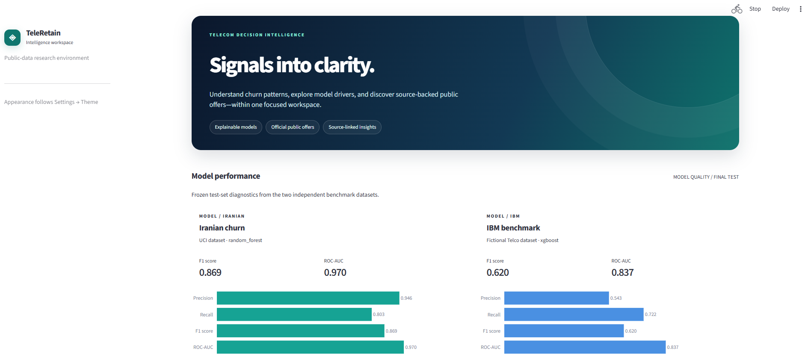
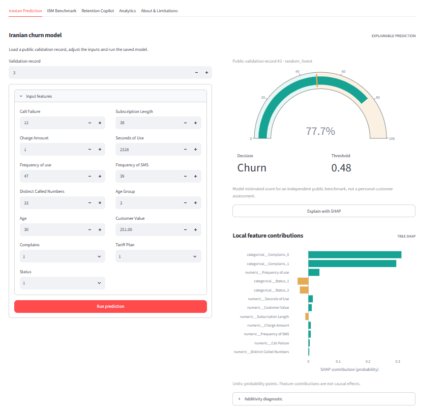
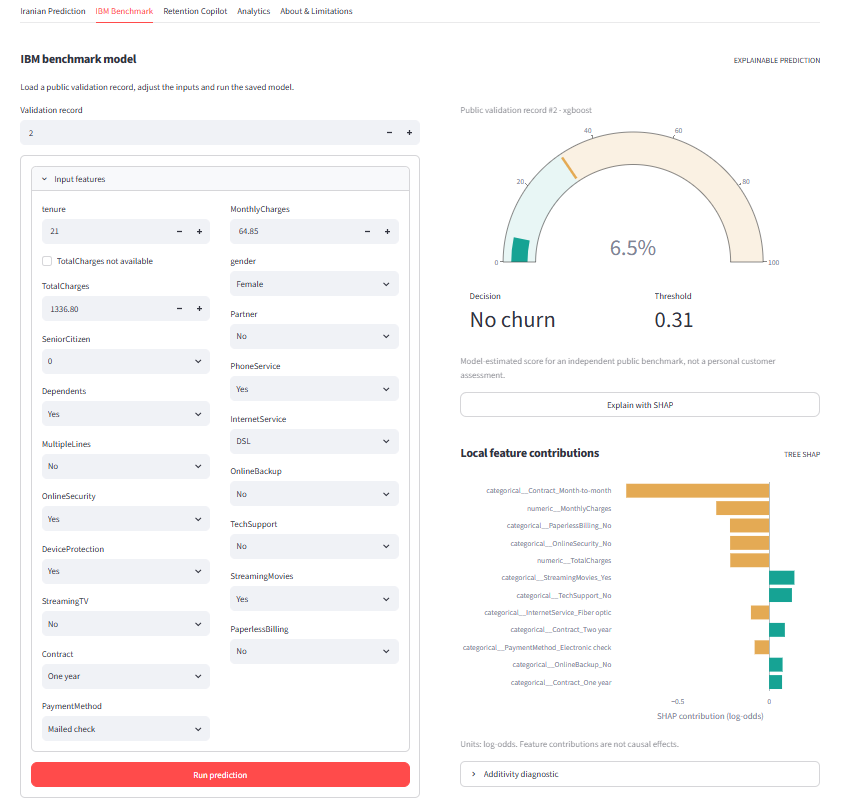
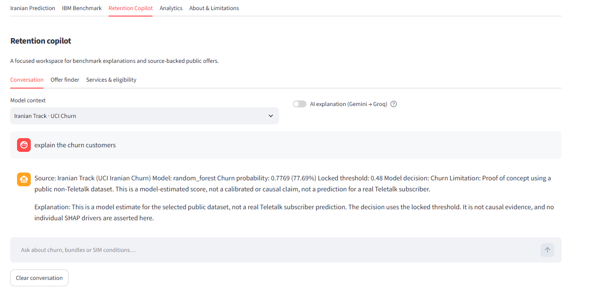
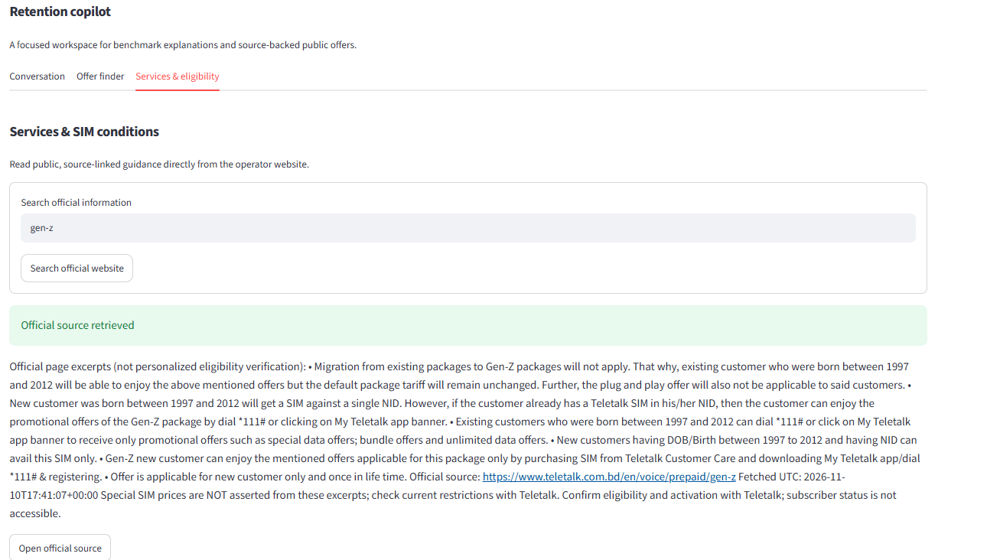
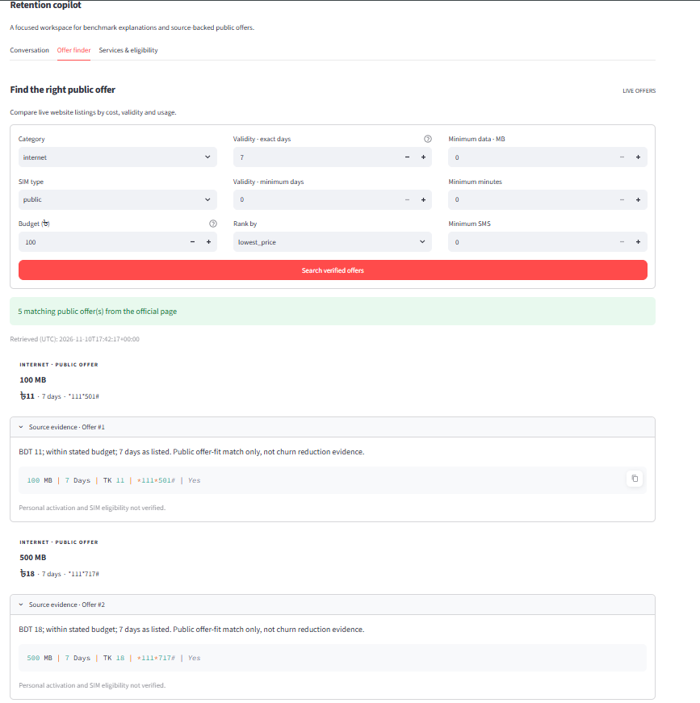
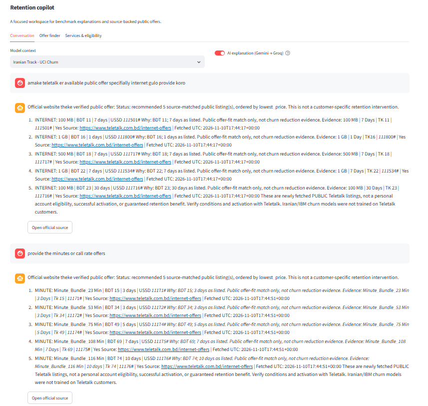
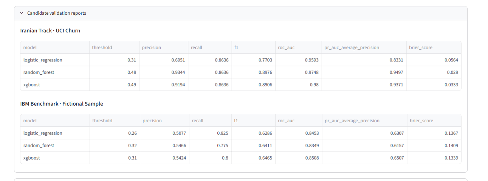

# TeleRetain AI

## Explainable Telecom Churn Analytics & Evidence-Grounded Retention Copilot

A privacy-conscious telecom analytics proof-of-concept that combines churn prediction, explainable AI, multilingual conversational assistance, public-information retrieval, and evidence-grounded offer discovery.

---

## Project Overview

TeleRetain AI was designed as an internship research and demonstration platform for telecom customer-retention analytics.

The project combines machine learning, explainable AI, conversational AI, Retrieval-Augmented Generation (RAG), and public information discovery into a unified Streamlit dashboard.

Key focus areas include:

- Telecom churn analysis
- Explainable AI using SHAP
- Multilingual AI interaction
- Public-information retrieval
- Evidence-grounded recommendations
- Privacy-conscious design

---

## System Architecture

```text
Streamlit Dashboard
        |
Input Validation & Dataset Routing
        |
 ┌─────────────────────────────────────┐
 │                                     │
 ▼                                     ▼

Iranian Churn Track           IBM Benchmark Track

Preprocessing                 Preprocessing
     |                              |
Random Forest                XGBoost
     |                              |
SHAP Explainability         SHAP Explainability

 └─────────────────────────────────────┘
                   |
                   ▼

      Conversational AI Copilot

                   |
                   ▼

      Public Information RAG

                   |
                   ▼

     Offer Recommendation Engine
```

---

## Core Design Principles

### Dataset Isolation

Two separate churn-analysis tracks are maintained:

#### Primary Track
- UCI Iranian Churn Dataset

#### Benchmark Track
- IBM Telco Customer Churn Dataset

The system is designed to prevent cross-track routing.

Iranian inputs must never be sent to IBM models.

IBM inputs must never be sent to Iranian models.

---

### Explainability First

TeleRetain AI focuses on transparent machine-learning workflows.

Planned explainability components:

- SHAP explanations
- Feature-attribution analysis
- Business-oriented interpretation
- Human-readable reasoning

---

### Responsible AI

The application should:

- Never fabricate package information
- Never invent customer records
- Never claim access to subscriber data
- Never imply production deployment
- Cite public sources whenever applicable

---

### Privacy-Conscious Design

The project intentionally avoids:

- Production systems
- Real customer data
- Billing records
- Subscriber records
- Call detail records (CDRs)

Only public information and approved public datasets are intended for use.

---

# Dashboard Showcase

---

## Home Dashboard

The main dashboard serves as the centralized interface for analytics, explainability, AI assistance, and public-information retrieval.

<p align="center">

</p>

---

## Iranian Churn Prediction and Explainability

The primary churn-prediction workflow built on the UCI Iranian Churn Dataset.

<p align="center">

</p>

### Capabilities

- Churn prediction
- Customer risk analysis
- SHAP explanations
- Feature-attribution visualization
- Explainable AI workflow

---

## IBM Telco Benchmark Analytics

Independent benchmark implementation based on the IBM Telco Customer Churn dataset.

<p align="center">

</p>

### Capabilities

- Benchmark evaluation
- Independent preprocessing
- Model comparison
- Explainability analysis
- Performance assessment

---

## Churn Explanation Copilot

An AI assistant capable of explaining model outputs and prediction behaviors.

<p align="center">

</p>

### Capabilities

- Explain predictions
- Explain SHAP outputs
- Summarize results
- Answer analytical questions
- Business-friendly interpretation

---

## Public Information Assistant

Retrieval-Augmented Generation (RAG) assistant for public telecom information.

<p align="center">

</p>

### Capabilities

- Public information retrieval
- Source-grounded answers
- Knowledge discovery
- Citation support
- Public service information

---

## Offer Recommendation Copilot

An evidence-grounded recommendation workflow built on verified public information.

<p align="center">

</p>

### Capabilities

- Offer discovery
- Information filtering
- Requirement matching
- Transparent recommendation logic
- Public-package exploration

---

## Multilingual Interaction

Support for English, Bangla, and Banglish interactions.

<p align="center">

</p>

### Supported Languages

- English
- বাংলা
- Banglish
- Mixed-language queries

---

## Validation Dashboard

Project validation and verification records.

<p align="center">

</p>

### Validation Scope

- Environment validation
- Data validation
- Pipeline checks
- Model validation
- Explainability validation
- Integration validation
- Dashboard validation

---

# Technology Stack

## Machine Learning

- Python
- Scikit-Learn
- XGBoost
- SHAP
- Pandas
- NumPy

## AI and RAG

- LangChain
- Gemini
- Groq
- FAISS

## Application Layer

- Streamlit
- Pydantic
- YAML Configuration

---

# Dataset Sources

## Primary Dataset

UCI Iranian Churn Dataset

https://archive.ics.uci.edu/dataset/563/iranian+churn+dataset

---

## Benchmark Dataset

IBM Telco Customer Churn Dataset

https://www.kaggle.com/datasets/blastchar/telco-customer-churn

---

# Installation

## Clone Repository

```bash
git clone https://github.com/Alimul-Islam-Eram-Khan/Teleretain-Ai.git

cd Teleretain-Ai
```

## Create Virtual Environment

```bash
python -m venv .venv
```

## Activate Environment

### Windows

```bash
.venv\Scripts\activate
```

### Git Bash

```bash
source .venv/Scripts/activate
```

## Install Dependencies

```bash
pip install -r requirements.txt
```

## Run Application

```bash
streamlit run app/streamlit_app.py
```

---

# Development Roadmap

### Stage 1
Environment Setup

### Stage 2
EDA and Preprocessing

### Stage 3
Model Training and Evaluation

### Stage 4
SHAP Explainability

### Stage 5
Validation and Dataset Routing

### Stage 6
Conversational Copilot

### Stage 7
Public Information RAG

### Stage 8
Dashboard Integration

### Stage 9
Testing, Documentation, and Presentation

---

---

# Limitations

1. No real customer data is included.
2. No production telecom systems are connected.
3. Public information may change over time.
4. Churn predictions are for research and demonstration purposes.
5. Results must not be interpreted as operational decisions.
6. SHAP explanations do not indicate causation.
7. Public package visibility does not guarantee eligibility.

---

# Author

**Alimul Islam Eram Khan**

IT & Billing Department

Teletalk Bangladesh Limited

---

# Disclaimer

This repository is an internship research and demonstration project.

It is not an official Teletalk product, production system, or subscriber-retention platform.

No real subscriber information, billing records, customer records, or operational telecom data are included in this repository.
